# Paper outputs with novelty comparison

Vu, Tran, and Kim, *Predictive Hybrid Autoscaling for Containerized Applications*, IEEE Access 2022.

Each trace uses its last 7200 observations in chronological order; the final 20% is held out. The DTR uses a synthetic development fixture, not a measured cluster model. Latency and cost are emulator estimates using Algorithm 2 and Equations (2)–(4).

## Figure 1 — system architecture

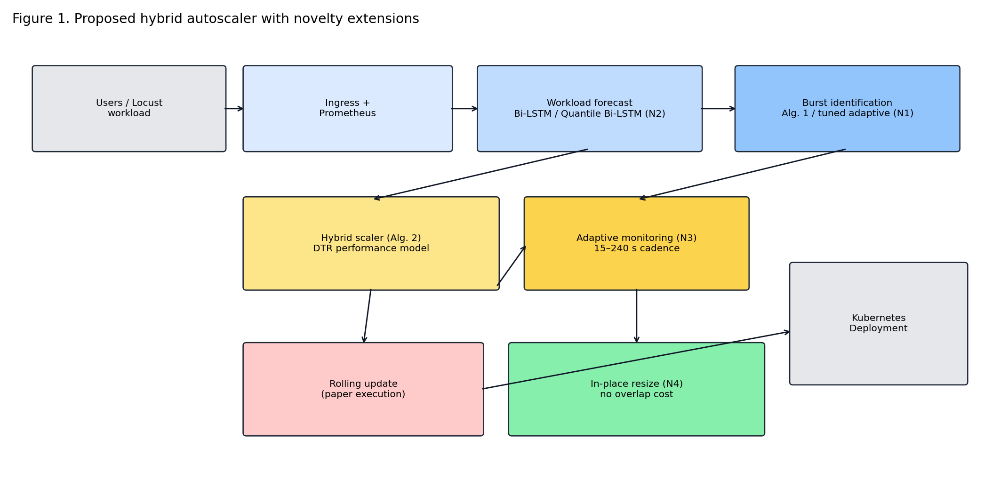

## Figure 2 — rolling update versus in-place resize

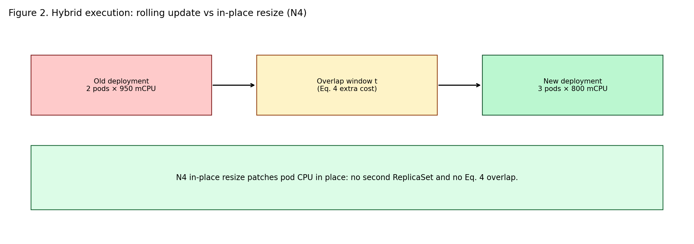

## Algorithms 1 and 2

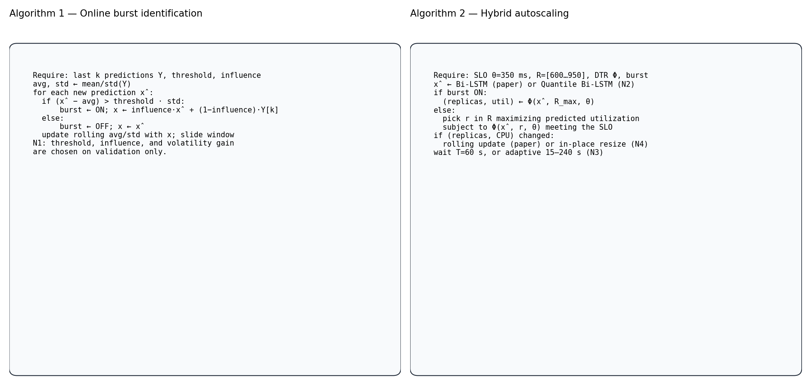

## Table III — parameter setting

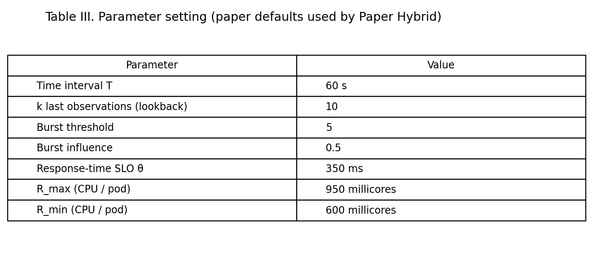

| parameter | value |
| --- | --- |
| Time interval T | 60 s |
| k last observations (lookback) | 10 |
| Burst threshold | 5 |
| Burst influence | 0.5 |
| Response-time SLO θ | 350 ms |
| R_max (CPU / pod) | 950 millicores |
| R_min (CPU / pod) | 600 millicores |

## Paper Table I — reported forecast errors (IEEE values, unit-interval scale)

| trace | model | RMSE | MAE |
| --- | --- | --- | --- |
| Wikipedia | ARIMA | 0.9850 | 0.6990 |
| Wikipedia | LR | 0.8720 | 0.6430 |
| Wikipedia | EN | 0.7780 | 0.5890 |
| Wikipedia | OLS | 0.9210 | 0.7300 |
| Wikipedia | NNLS | 0.8790 | 0.6200 |
| Wikipedia | LSTM | 0.7420 | 0.5420 |
| Wikipedia | Bi-LSTM | 0.6550 | 0.4660 |
| FIFA World Cup | ARIMA | 0.8750 | 0.5230 |
| FIFA World Cup | LR | 0.7090 | 0.6230 |
| FIFA World Cup | EN | 0.6360 | 0.4190 |
| FIFA World Cup | OLS | 0.9100 | 0.6600 |
| FIFA World Cup | NNLS | 0.8800 | 0.6530 |
| FIFA World Cup | LSTM | 0.5090 | 0.3230 |
| FIFA World Cup | Bi-LSTM | 0.4360 | 0.2890 |

## Paper Table II — reported performance-model errors

| model | MSE | MAE |
| --- | --- | --- |
| LR | 0.8360 | 3.2700 |
| RDF | 0.9840 | 3.5100 |
| SVR | 0.5230 | 2.9800 |
| XGB | 0.2680 | 2.6700 |
| MLP | 0.7320 | 3.1400 |
| DTR | 0.1090 | 1.8100 |

## Paper Table 4 — published SLO violation results

These are transcribed from the paper's published table; they are separate from the project emulator results below.

| Trace | Burst zone | Reactive HPA (%) | Proactive HPA (%) | Paper proposal (%) |
|---|---|---:|---:|---:|
| Wikipedia | ON | 22.14 | 2.87 | 2.96 |
| Wikipedia | OFF | 8.63 | 1.14 | 1.53 |
| FIFA World Cup | ON | 20.54 | 4.10 | 3.89 |
| FIFA World Cup | OFF | 5.47 | 1.57 | 1.86 |

## Paper Table 5 — published average pod utilization results

| Trace | Burst zone | Reactive HPA (%) | Proactive HPA (%) | Paper proposal (%) |
|---|---|---:|---:|---:|
| Wikipedia | ON | 76.68 | 73.51 | 73.73 |
| Wikipedia | OFF | 61.78 | 55.26 | 69.65 |
| FIFA World Cup | ON | 78.30 | 72.68 | 72.58 |
| FIFA World Cup | OFF | 64.58 | 63.96 | 74.17 |

## Paper Table 6 — published burst-case comparison

| Trace | Burst-aware HPA SLO (%) | Burst-aware HPA normalized cost | Paper proposal SLO (%) | Paper proposal normalized cost |
|---|---:|---:|---:|---:|
| Wikipedia | 3.11 | 0.793 | 2.96 | 0.608 |
| FIFA World Cup | 4.05 | 0.809 | 3.89 | 0.612 |

## Project Table II — performance-model errors (Locust-style generated DTR data)

| name | macro_mse | macro_mae | replicas_mse | replicas_mae | utilization_mse | utilization_mae |
| --- | --- | --- | --- | --- | --- | --- |
| LR | 0.1223 | 0.2504 | 0.2222 | 0.3958 | 0.0225 | 0.1050 |
| RDF | 0.0559 | 0.1407 | 0.1057 | 0.2196 | 0.0062 | 0.0618 |
| SVR | 0.0651 | 0.1959 | 0.1134 | 0.2973 | 0.0168 | 0.0944 |
| XGB | 0.0435 | 0.1556 | 0.0806 | 0.2522 | 0.0064 | 0.0590 |
| MLP | 1.0037 | 0.7074 | 1.8974 | 1.1909 | 0.1100 | 0.2240 |
| DTR | 0.0795 | 0.1170 | 0.1488 | 0.1548 | 0.0101 | 0.0791 |

## worldcup98_fifa

Paper Hybrid SLO 0.069%, cost 161.071, util 60.67%. Standalone N4 in-place SLO 0.000%, cost 155.520, util 60.65%. All-four novelties SLO 0.347%, cost 135.846, util 69.39% (SLO not lower, cost better, util higher or equal).

Standalone N4 paired deltas vs Paper Hybrid: SLO -0.069 pp (95% CI [-0.208, 0.000]); cost -5.551 (95% CI [-6.351, -4.881]).

### Table I — forecast errors on the held-out window

Raw columns are on the capacity-scaled request-rate axis. `rmse_unit_interval` / `mae_unit_interval` divide by the training span, matching the paper's (0, 1) reporting.

| name | rmse | mae | rmse_unit_interval | mae_unit_interval | parameters |
| --- | --- | --- | --- | --- | --- |
| LR | 134.6641 | 108.0696 | 0.0523 | 0.0420 | lag=10 |
| EN | 134.6641 | 108.0696 | 0.0523 | 0.0420 | lag=10 |
| OLS | 134.6641 | 108.0696 | 0.0523 | 0.0420 | lag=10 |
| NNLS | 134.6641 | 108.0696 | 0.0523 | 0.0420 | lag=10 |
| ARIMA | 180.9785 | 148.4906 | 0.0703 | 0.0576 | ARIMA(1,0,0), expanding state |
| Bi-LSTM | 282.8806 | 266.2961 | 0.1098 | 0.1034 | lookback=10, hidden=32, held-out one-step from ablation |
| Quantile Bi-LSTM (P50) | 110.2016 | 89.5422 | 0.0428 | 0.0348 | lookback=10, hidden=32, held-out P50 from ablation |

### Figures 3/4 — forecast and burst identification

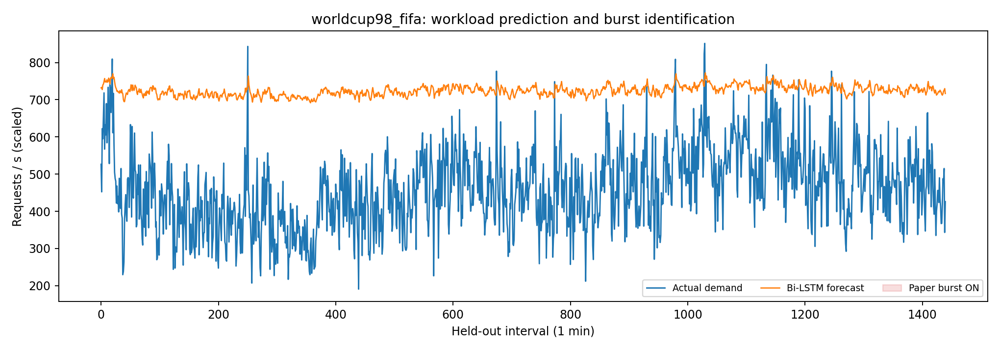

### Figures 5/6 — CPU, replicas, utilization, response time

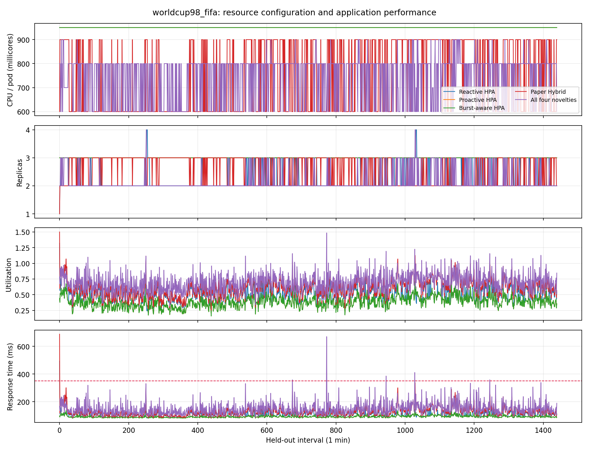

### Figure 7 — resource cost

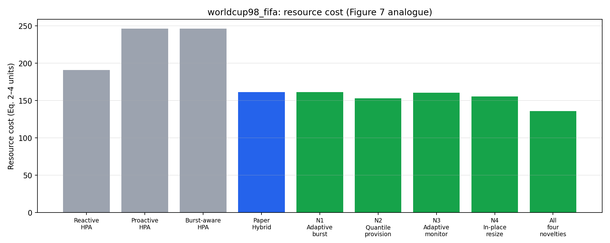

### Paper Hybrid versus novelties

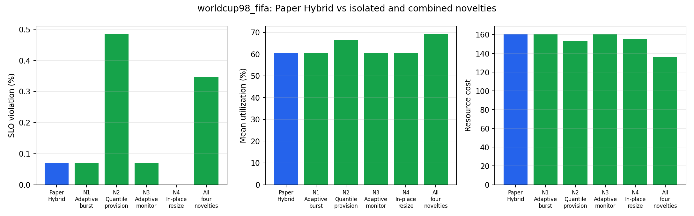

### Table 4 — percentage of total SLO violation by burst zone

| zone | Reactive HPA | Proactive HPA | Paper Hybrid | All four novelties |
| --- | --- | --- | --- | --- |
| ON |  |  |  |  |
| OFF | 0.06944444444444445 | 0.0 | 0.06944444444444445 | 0.3472222222222222 |

### Table 5 — percentage of average pod utilization by burst zone

| zone | Reactive HPA | Proactive HPA | Paper Hybrid | All four novelties |
| --- | --- | --- | --- | --- |
| ON |  |  |  |  |
| OFF | 50.55338947170412 | 38.32894656765068 | 60.66737276413993 | 69.3943879867246 |

### Tables 4 and 5 — full per-policy zone metrics

| trace | variant | display | zone | intervals | slo_violation_pct | mean_utilization_pct | resource_cost | mean_response_ms |
| --- | --- | --- | --- | --- | --- | --- | --- | --- |
| worldcup98_fifa | burst_aware_hpa_bilstm_fixed_cpu | Burst-aware HPA | non_burst | 1440 | 0.0000 | 38.3289 | 246.2400 | 91.7977 |
| worldcup98_fifa | novelty_1_tuned_adaptive_burst | N1 Adaptive burst | non_burst | 1440 | 0.0694 | 60.6674 | 161.0712 | 127.2087 |
| worldcup98_fifa | novelty_2_quantile_provisioning | N2 Quantile provision | non_burst | 1440 | 0.4861 | 66.6446 | 152.8032 | 141.3666 |
| worldcup98_fifa | novelty_3_adaptive_monitoring | N3 Adaptive monitor | non_burst | 1440 | 0.0694 | 60.6674 | 160.3584 | 127.2087 |
| worldcup98_fifa | novelty_4_inplace_resize | N4 In-place resize | non_burst | 1440 | 0.0000 | 60.6463 | 155.5200 | 126.8290 |
| worldcup98_fifa | optimized_novelty_n1_burst_n2_quantile | optimized_novelty_n1_burst_n2_quantile | non_burst | 1440 | 0.4861 | 66.6469 | 152.8296 | 141.3570 |
| worldcup98_fifa | optimized_novelty_n1_burst_n2_quantile_n3_monitoring | optimized_novelty_n1_burst_n2_quantile_n3_monitoring | non_burst | 1440 | 0.4861 | 66.4937 | 152.7744 | 140.8312 |
| worldcup98_fifa | optimized_novelty_n1_burst_n2_quantile_n3_monitoring_n4_inplace | All four novelties | non_burst | 1440 | 0.3472 | 69.3944 | 135.8460 | 148.2635 |
| worldcup98_fifa | optimized_novelty_n1_burst_n2_quantile_n4_inplace | optimized_novelty_n1_burst_n2_quantile_n4_inplace | non_burst | 1440 | 0.3472 | 69.5089 | 135.5700 | 148.6356 |
| worldcup98_fifa | optimized_novelty_n1_burst_n3_monitoring | optimized_novelty_n1_burst_n3_monitoring | non_burst | 1440 | 0.0694 | 60.6674 | 160.3584 | 127.2087 |
| worldcup98_fifa | optimized_novelty_n1_burst_n3_monitoring_n4_inplace | optimized_novelty_n1_burst_n3_monitoring_n4_inplace | non_burst | 1440 | 0.0000 | 60.6463 | 155.5200 | 126.8290 |
| worldcup98_fifa | optimized_novelty_n1_burst_n4_inplace | optimized_novelty_n1_burst_n4_inplace | non_burst | 1440 | 0.0000 | 60.6463 | 155.5200 | 126.8290 |
| worldcup98_fifa | optimized_novelty_n2_quantile_n3_monitoring | optimized_novelty_n2_quantile_n3_monitoring | non_burst | 1440 | 0.4861 | 66.4914 | 152.7480 | 140.8407 |
| worldcup98_fifa | optimized_novelty_n2_quantile_n3_monitoring_n4_inplace | optimized_novelty_n2_quantile_n3_monitoring_n4_inplace | non_burst | 1440 | 0.3472 | 69.3899 | 135.8640 | 148.2579 |
| worldcup98_fifa | optimized_novelty_n2_quantile_n4_inplace | optimized_novelty_n2_quantile_n4_inplace | non_burst | 1440 | 0.3472 | 69.5045 | 135.5880 | 148.6299 |
| worldcup98_fifa | optimized_novelty_n3_monitoring_n4_inplace | optimized_novelty_n3_monitoring_n4_inplace | non_burst | 1440 | 0.0000 | 60.6463 | 155.5200 | 126.8290 |
| worldcup98_fifa | paper_hybrid_bilstm_dtr_rolling_fixed_monitor | Paper Hybrid | non_burst | 1440 | 0.0694 | 60.6674 | 161.0712 | 127.2087 |
| worldcup98_fifa | proactive_hpa_bilstm_fixed_cpu | Proactive HPA | non_burst | 1440 | 0.0000 | 38.3289 | 246.2400 | 91.7977 |
| worldcup98_fifa | reactive_hpa_fixed_cpu | Reactive HPA | non_burst | 1440 | 0.0694 | 50.5534 | 190.6080 | 107.6025 |

### Table 6 — burst-window SLO and normalized cost

| trace | variant | display | burst_intervals | burst_slo_violation_pct | burst_resource_cost | normalized_burst_cost |
| --- | --- | --- | --- | --- | --- | --- |
| worldcup98_fifa | burst_aware_hpa_bilstm_fixed_cpu | Burst-aware HPA | 0 |  | 0.0000 |  |
| worldcup98_fifa | novelty_1_tuned_adaptive_burst | N1 Adaptive burst | 0 |  | 0.0000 |  |
| worldcup98_fifa | novelty_2_quantile_provisioning | N2 Quantile provision | 0 |  | 0.0000 |  |
| worldcup98_fifa | novelty_3_adaptive_monitoring | N3 Adaptive monitor | 0 |  | 0.0000 |  |
| worldcup98_fifa | novelty_4_inplace_resize | N4 In-place resize | 0 |  | 0.0000 |  |
| worldcup98_fifa | optimized_novelty_n1_burst_n2_quantile | optimized_novelty_n1_burst_n2_quantile | 0 |  | 0.0000 |  |
| worldcup98_fifa | optimized_novelty_n1_burst_n2_quantile_n3_monitoring | optimized_novelty_n1_burst_n2_quantile_n3_monitoring | 0 |  | 0.0000 |  |
| worldcup98_fifa | optimized_novelty_n1_burst_n2_quantile_n3_monitoring_n4_inplace | All four novelties | 0 |  | 0.0000 |  |
| worldcup98_fifa | optimized_novelty_n1_burst_n2_quantile_n4_inplace | optimized_novelty_n1_burst_n2_quantile_n4_inplace | 0 |  | 0.0000 |  |
| worldcup98_fifa | optimized_novelty_n1_burst_n3_monitoring | optimized_novelty_n1_burst_n3_monitoring | 0 |  | 0.0000 |  |
| worldcup98_fifa | optimized_novelty_n1_burst_n3_monitoring_n4_inplace | optimized_novelty_n1_burst_n3_monitoring_n4_inplace | 0 |  | 0.0000 |  |
| worldcup98_fifa | optimized_novelty_n1_burst_n4_inplace | optimized_novelty_n1_burst_n4_inplace | 0 |  | 0.0000 |  |
| worldcup98_fifa | optimized_novelty_n2_quantile_n3_monitoring | optimized_novelty_n2_quantile_n3_monitoring | 0 |  | 0.0000 |  |
| worldcup98_fifa | optimized_novelty_n2_quantile_n3_monitoring_n4_inplace | optimized_novelty_n2_quantile_n3_monitoring_n4_inplace | 0 |  | 0.0000 |  |
| worldcup98_fifa | optimized_novelty_n2_quantile_n4_inplace | optimized_novelty_n2_quantile_n4_inplace | 0 |  | 0.0000 |  |
| worldcup98_fifa | optimized_novelty_n3_monitoring_n4_inplace | optimized_novelty_n3_monitoring_n4_inplace | 0 |  | 0.0000 |  |
| worldcup98_fifa | paper_hybrid_bilstm_dtr_rolling_fixed_monitor | Paper Hybrid | 0 |  | 0.0000 |  |
| worldcup98_fifa | proactive_hpa_bilstm_fixed_cpu | Proactive HPA | 0 |  | 0.0000 |  |
| worldcup98_fifa | reactive_hpa_fixed_cpu | Reactive HPA | 0 |  | 0.0000 |  |

### Full policy summary versus Paper Hybrid

| variant | slo_violation_pct | mean_utilization_pct | resource_cost | rolling_overlap_cost | monitor_cycles |
| --- | --- | --- | --- | --- | --- |
| reactive_hpa_fixed_cpu | 0.0694 | 50.5534 | 190.6080 | 0.0000 | 1440 |
| proactive_hpa_bilstm_fixed_cpu | 0.0000 | 38.3289 | 246.2400 | 0.0000 | 1440 |
| burst_aware_hpa_bilstm_fixed_cpu | 0.0000 | 38.3289 | 246.2400 | 0.0000 | 1440 |
| paper_hybrid_bilstm_dtr_rolling_fixed_monitor | 0.0694 | 60.6674 | 161.0712 | 11.2608 | 1440 |
| novelty_1_tuned_adaptive_burst | 0.0694 | 60.6674 | 161.0712 | 11.2608 | 1440 |
| novelty_2_quantile_provisioning | 0.4861 | 66.6446 | 152.8032 | 22.5204 | 1440 |
| novelty_3_adaptive_monitoring | 0.0694 | 60.6674 | 160.3584 | 9.8352 | 1126 |
| novelty_4_inplace_resize | 0.0000 | 60.6463 | 155.5200 | 0.0000 | 1440 |
| optimized_novelty_n1_burst_n2_quantile | 0.4861 | 66.6469 | 152.8296 | 22.6092 | 1440 |
| optimized_novelty_n1_burst_n3_monitoring | 0.0694 | 60.6674 | 160.3584 | 9.8352 | 1126 |
| optimized_novelty_n1_burst_n4_inplace | 0.0000 | 60.6463 | 155.5200 | 0.0000 | 1440 |
| optimized_novelty_n2_quantile_n3_monitoring | 0.4861 | 66.4914 | 152.7480 | 21.6900 | 1412 |
| optimized_novelty_n2_quantile_n4_inplace | 0.3472 | 69.5045 | 135.5880 | 0.0000 | 1440 |
| optimized_novelty_n3_monitoring_n4_inplace | 0.0000 | 60.6463 | 155.5200 | 0.0000 | 1126 |
| optimized_novelty_n1_burst_n2_quantile_n3_monitoring | 0.4861 | 66.4937 | 152.7744 | 21.7788 | 1412 |
| optimized_novelty_n1_burst_n2_quantile_n4_inplace | 0.3472 | 69.5089 | 135.5700 | 0.0000 | 1440 |
| optimized_novelty_n1_burst_n3_monitoring_n4_inplace | 0.0000 | 60.6463 | 155.5200 | 0.0000 | 1126 |
| optimized_novelty_n2_quantile_n3_monitoring_n4_inplace | 0.3472 | 69.3899 | 135.8640 | 0.0000 | 1412 |
| optimized_novelty_n1_burst_n2_quantile_n3_monitoring_n4_inplace | 0.3472 | 69.3944 | 135.8460 | 0.0000 | 1412 |

### Paired deltas versus Paper Hybrid (negative favors novelty)

| variant | slo_violation_pct | delta_slo_violation_pct | resource_cost | delta_resource_cost |
| --- | --- | --- | --- | --- |
| novelty_1_tuned_adaptive_burst | 0.0694 | 0.0000 | 161.0712 | 0.0000 |
| novelty_2_quantile_provisioning | 0.4861 | 0.4167 | 152.8032 | -8.2680 |
| novelty_3_adaptive_monitoring | 0.0694 | 0.0000 | 160.3584 | -0.7128 |
| novelty_4_inplace_resize | 0.0000 | -0.0694 | 155.5200 | -5.5512 |
| optimized_novelty_n1_burst_n2_quantile | 0.4861 | 0.4167 | 152.8296 | -8.2416 |
| optimized_novelty_n1_burst_n3_monitoring | 0.0694 | 0.0000 | 160.3584 | -0.7128 |
| optimized_novelty_n1_burst_n4_inplace | 0.0000 | -0.0694 | 155.5200 | -5.5512 |
| optimized_novelty_n2_quantile_n3_monitoring | 0.4861 | 0.4167 | 152.7480 | -8.3232 |
| optimized_novelty_n2_quantile_n4_inplace | 0.3472 | 0.2778 | 135.5880 | -25.4832 |
| optimized_novelty_n3_monitoring_n4_inplace | 0.0000 | -0.0694 | 155.5200 | -5.5512 |
| optimized_novelty_n1_burst_n2_quantile_n3_monitoring | 0.4861 | 0.4167 | 152.7744 | -8.2968 |
| optimized_novelty_n1_burst_n2_quantile_n4_inplace | 0.3472 | 0.2778 | 135.5700 | -25.5012 |
| optimized_novelty_n1_burst_n3_monitoring_n4_inplace | 0.0000 | -0.0694 | 155.5200 | -5.5512 |
| optimized_novelty_n2_quantile_n3_monitoring_n4_inplace | 0.3472 | 0.2778 | 135.8640 | -25.2072 |
| optimized_novelty_n1_burst_n2_quantile_n3_monitoring_n4_inplace | 0.3472 | 0.2778 | 135.8460 | -25.2252 |

## azurefunctions2019_wikipedia_like

Paper Hybrid SLO 5.764%, cost 274.018, util 99.32%. Standalone N4 in-place SLO 4.931%, cost 267.432, util 99.40%. All-four novelties SLO 0.208%, cost 324.774, util 86.72% (SLO better, cost not lower, util lower).

Standalone N4 paired deltas vs Paper Hybrid: SLO -0.833 pp (95% CI [-1.319, -0.276]); cost -6.586 (95% CI [-7.686, -5.614]).

### Table I — forecast errors on the held-out window

Raw columns are on the capacity-scaled request-rate axis. `rmse_unit_interval` / `mae_unit_interval` divide by the training span, matching the paper's (0, 1) reporting.

| name | rmse | mae | rmse_unit_interval | mae_unit_interval | parameters |
| --- | --- | --- | --- | --- | --- |
| LR | 25081.5049 | 16920.6042 | 0.0656 | 0.0443 | lag=10 |
| EN | 25081.5049 | 16920.6042 | 0.0656 | 0.0443 | lag=10 |
| OLS | 25081.5049 | 16920.6042 | 0.0656 | 0.0443 | lag=10 |
| NNLS | 25184.7959 | 17123.3612 | 0.0659 | 0.0448 | lag=10 |
| ARIMA | 26996.9319 | 18578.1973 | 0.0706 | 0.0486 | ARIMA(1,0,0), expanding state |
| Bi-LSTM | 111.2041 | 88.4701 | 0.0003 | 0.0002 | lookback=10, hidden=32, held-out one-step from ablation |
| Quantile Bi-LSTM (P50) | 70.8226 | 57.9878 | 0.0002 | 0.0002 | lookback=10, hidden=32, held-out P50 from ablation |

### Figures 3/4 — forecast and burst identification

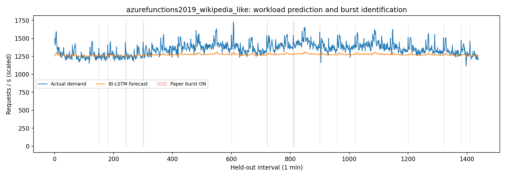

### Figures 5/6 — CPU, replicas, utilization, response time

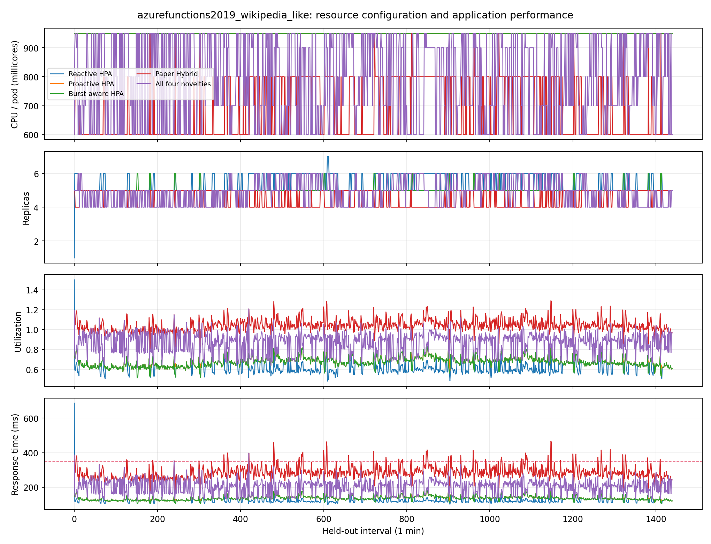

### Figure 7 — resource cost

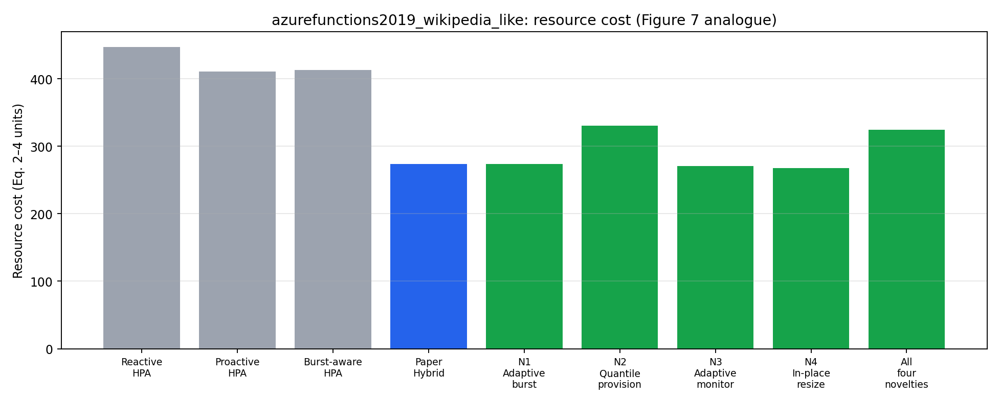

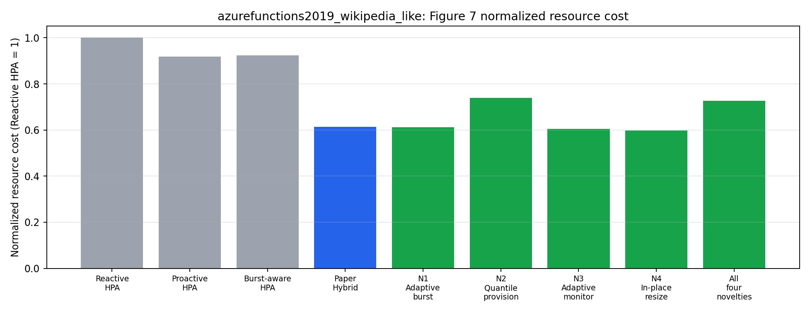

### Paper Hybrid versus novelties

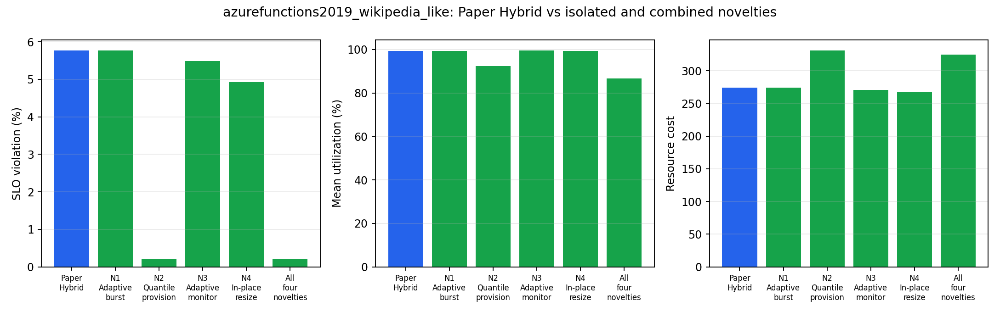

### Table 4 — percentage of total SLO violation by burst zone

| zone | Reactive HPA | Proactive HPA | Paper Hybrid | All four novelties |
| --- | --- | --- | --- | --- |
| ON | 0.0000 | 0.0000 | 22.2222 | 0.0000 |
| OFF | 0.0703 | 0.0000 | 5.5556 | 0.2110 |

### Table 5 — percentage of average pod utilization by burst zone

| zone | Reactive HPA | Proactive HPA | Paper Hybrid | All four novelties |
| --- | --- | --- | --- | --- |
| ON | 66.2630 | 69.4751 | 96.6983 | 77.2167 |
| OFF | 62.5252 | 67.7749 | 99.3535 | 86.8379 |

### Tables 4 and 5 — full per-policy zone metrics

| trace | variant | display | zone | intervals | slo_violation_pct | mean_utilization_pct | resource_cost | mean_response_ms |
| --- | --- | --- | --- | --- | --- | --- | --- | --- |
| azurefunctions2019_wikipedia_like | burst_aware_hpa_bilstm_fixed_cpu | Burst-aware HPA | burst | 18 | 0.0000 | 57.8960 | 6.1560 | 115.2098 |
| azurefunctions2019_wikipedia_like | burst_aware_hpa_bilstm_fixed_cpu | Burst-aware HPA | non_burst | 1422 | 0.0000 | 67.5545 | 406.8660 | 136.2765 |
| azurefunctions2019_wikipedia_like | novelty_1_tuned_adaptive_burst | N1 Adaptive burst | burst | 18 | 22.2222 | 96.6983 | 3.6384 | 289.8247 |
| azurefunctions2019_wikipedia_like | novelty_1_tuned_adaptive_burst | N1 Adaptive burst | non_burst | 1422 | 5.5556 | 99.3856 | 270.2928 | 285.1774 |
| azurefunctions2019_wikipedia_like | novelty_2_quantile_provisioning | N2 Quantile provision | burst | 18 | 0.0000 | 93.0270 | 4.0872 | 234.1615 |
| azurefunctions2019_wikipedia_like | novelty_2_quantile_provisioning | N2 Quantile provision | non_burst | 1422 | 0.2110 | 92.4227 | 326.7000 | 225.4129 |
| azurefunctions2019_wikipedia_like | novelty_3_adaptive_monitoring | N3 Adaptive monitor | burst | 18 | 16.6667 | 99.8501 | 3.2880 | 310.8327 |
| azurefunctions2019_wikipedia_like | novelty_3_adaptive_monitoring | N3 Adaptive monitor | non_burst | 1422 | 5.3446 | 99.4428 | 267.3432 | 285.6387 |
| azurefunctions2019_wikipedia_like | novelty_4_inplace_resize | N4 In-place resize | burst | 18 | 0.0000 | 86.8439 | 4.1040 | 198.8332 |
| azurefunctions2019_wikipedia_like | novelty_4_inplace_resize | N4 In-place resize | non_burst | 1422 | 4.9930 | 99.5582 | 263.3280 | 285.7881 |
| azurefunctions2019_wikipedia_like | optimized_novelty_n1_burst_n2_quantile | optimized_novelty_n1_burst_n2_quantile | burst | 18 | 0.0000 | 85.0201 | 4.7688 | 201.9114 |
| azurefunctions2019_wikipedia_like | optimized_novelty_n1_burst_n2_quantile | optimized_novelty_n1_burst_n2_quantile | non_burst | 1422 | 0.2110 | 85.0830 | 358.6806 | 197.4684 |
| azurefunctions2019_wikipedia_like | optimized_novelty_n1_burst_n2_quantile_n3_monitoring | optimized_novelty_n1_burst_n2_quantile_n3_monitoring | burst | 18 | 0.0000 | 86.0565 | 4.6008 | 205.8719 |
| azurefunctions2019_wikipedia_like | optimized_novelty_n1_burst_n2_quantile_n3_monitoring | optimized_novelty_n1_burst_n2_quantile_n3_monitoring | non_burst | 1422 | 0.1406 | 86.8817 | 344.8242 | 203.8529 |
| azurefunctions2019_wikipedia_like | optimized_novelty_n1_burst_n2_quantile_n3_monitoring_n4_inplace | All four novelties | burst | 18 | 0.0000 | 77.2167 | 4.6980 | 169.5658 |
| azurefunctions2019_wikipedia_like | optimized_novelty_n1_burst_n2_quantile_n3_monitoring_n4_inplace | All four novelties | non_burst | 1422 | 0.2110 | 86.8379 | 320.0760 | 203.0141 |
| azurefunctions2019_wikipedia_like | optimized_novelty_n1_burst_n2_quantile_n4_inplace | optimized_novelty_n1_burst_n2_quantile_n4_inplace | burst | 18 | 0.0000 | 71.4655 | 4.9950 | 146.6987 |
| azurefunctions2019_wikipedia_like | optimized_novelty_n1_burst_n2_quantile_n4_inplace | optimized_novelty_n1_burst_n2_quantile_n4_inplace | non_burst | 1422 | 0.2110 | 85.0929 | 327.7470 | 196.6577 |
| azurefunctions2019_wikipedia_like | optimized_novelty_n1_burst_n3_monitoring | optimized_novelty_n1_burst_n3_monitoring | burst | 18 | 16.6667 | 99.8501 | 3.2880 | 310.8327 |
| azurefunctions2019_wikipedia_like | optimized_novelty_n1_burst_n3_monitoring | optimized_novelty_n1_burst_n3_monitoring | non_burst | 1422 | 5.3446 | 99.4345 | 267.4248 | 285.5803 |
| azurefunctions2019_wikipedia_like | optimized_novelty_n1_burst_n3_monitoring_n4_inplace | optimized_novelty_n1_burst_n3_monitoring_n4_inplace | burst | 18 | 11.1111 | 99.8106 | 3.3240 | 303.6743 |
| azurefunctions2019_wikipedia_like | optimized_novelty_n1_burst_n3_monitoring_n4_inplace | optimized_novelty_n1_burst_n3_monitoring_n4_inplace | non_burst | 1422 | 4.9930 | 99.4736 | 263.5320 | 285.5307 |
| azurefunctions2019_wikipedia_like | optimized_novelty_n1_burst_n4_inplace | optimized_novelty_n1_burst_n4_inplace | burst | 18 | 0.0000 | 89.9958 | 3.9360 | 219.9995 |
| azurefunctions2019_wikipedia_like | optimized_novelty_n1_burst_n4_inplace | optimized_novelty_n1_burst_n4_inplace | non_burst | 1422 | 4.9930 | 99.5507 | 263.3640 | 285.7270 |
| azurefunctions2019_wikipedia_like | optimized_novelty_n2_quantile_n3_monitoring | optimized_novelty_n2_quantile_n3_monitoring | burst | 18 | 0.0000 | 93.0270 | 4.0920 | 234.1615 |
| azurefunctions2019_wikipedia_like | optimized_novelty_n2_quantile_n3_monitoring | optimized_novelty_n2_quantile_n3_monitoring | non_burst | 1422 | 0.1406 | 92.1223 | 318.1428 | 223.8140 |
| azurefunctions2019_wikipedia_like | optimized_novelty_n2_quantile_n3_monitoring_n4_inplace | optimized_novelty_n2_quantile_n3_monitoring_n4_inplace | burst | 18 | 0.0000 | 79.7146 | 4.5360 | 176.3151 |
| azurefunctions2019_wikipedia_like | optimized_novelty_n2_quantile_n3_monitoring_n4_inplace | optimized_novelty_n2_quantile_n3_monitoring_n4_inplace | non_burst | 1422 | 0.1406 | 92.2203 | 297.5700 | 223.5211 |
| azurefunctions2019_wikipedia_like | optimized_novelty_n2_quantile_n4_inplace | optimized_novelty_n2_quantile_n4_inplace | burst | 18 | 0.0000 | 77.4297 | 4.6500 | 166.5665 |
| azurefunctions2019_wikipedia_like | optimized_novelty_n2_quantile_n4_inplace | optimized_novelty_n2_quantile_n4_inplace | non_burst | 1422 | 0.2110 | 92.5509 | 296.4870 | 225.1202 |
| azurefunctions2019_wikipedia_like | optimized_novelty_n3_monitoring_n4_inplace | optimized_novelty_n3_monitoring_n4_inplace | burst | 18 | 11.1111 | 99.8106 | 3.3240 | 303.6743 |
| azurefunctions2019_wikipedia_like | optimized_novelty_n3_monitoring_n4_inplace | optimized_novelty_n3_monitoring_n4_inplace | non_burst | 1422 | 4.9930 | 99.4810 | 263.4960 | 285.5917 |
| azurefunctions2019_wikipedia_like | paper_hybrid_bilstm_dtr_rolling_fixed_monitor | Paper Hybrid | burst | 18 | 22.2222 | 96.6983 | 3.6384 | 289.8247 |
| azurefunctions2019_wikipedia_like | paper_hybrid_bilstm_dtr_rolling_fixed_monitor | Paper Hybrid | non_burst | 1422 | 5.5556 | 99.3535 | 270.3792 | 284.9703 |
| azurefunctions2019_wikipedia_like | proactive_hpa_bilstm_fixed_cpu | Proactive HPA | burst | 18 | 0.0000 | 69.4751 | 5.1300 | 140.8426 |
| azurefunctions2019_wikipedia_like | proactive_hpa_bilstm_fixed_cpu | Proactive HPA | non_burst | 1422 | 0.0000 | 67.7749 | 405.2700 | 136.7315 |
| azurefunctions2019_wikipedia_like | reactive_hpa_fixed_cpu | Reactive HPA | burst | 18 | 0.0000 | 66.2630 | 5.4150 | 133.7748 |
| azurefunctions2019_wikipedia_like | reactive_hpa_fixed_cpu | Reactive HPA | non_burst | 1422 | 0.0703 | 62.5252 | 441.6360 | 125.2358 |

### Table 6 — burst-window SLO and normalized cost

| trace | variant | display | burst_intervals | burst_slo_violation_pct | burst_resource_cost | normalized_burst_cost |
| --- | --- | --- | --- | --- | --- | --- |
| azurefunctions2019_wikipedia_like | burst_aware_hpa_bilstm_fixed_cpu | Burst-aware HPA | 18 | 0.0000 | 6.1560 | 1.6920 |
| azurefunctions2019_wikipedia_like | novelty_1_tuned_adaptive_burst | N1 Adaptive burst | 18 | 22.2222 | 3.6384 | 1.0000 |
| azurefunctions2019_wikipedia_like | novelty_2_quantile_provisioning | N2 Quantile provision | 18 | 0.0000 | 4.0872 | 1.1234 |
| azurefunctions2019_wikipedia_like | novelty_3_adaptive_monitoring | N3 Adaptive monitor | 18 | 16.6667 | 3.2880 | 0.9037 |
| azurefunctions2019_wikipedia_like | novelty_4_inplace_resize | N4 In-place resize | 18 | 0.0000 | 4.1040 | 1.1280 |
| azurefunctions2019_wikipedia_like | optimized_novelty_n1_burst_n2_quantile | optimized_novelty_n1_burst_n2_quantile | 18 | 0.0000 | 4.7688 | 1.3107 |
| azurefunctions2019_wikipedia_like | optimized_novelty_n1_burst_n2_quantile_n3_monitoring | optimized_novelty_n1_burst_n2_quantile_n3_monitoring | 18 | 0.0000 | 4.6008 | 1.2645 |
| azurefunctions2019_wikipedia_like | optimized_novelty_n1_burst_n2_quantile_n3_monitoring_n4_inplace | All four novelties | 18 | 0.0000 | 4.6980 | 1.2912 |
| azurefunctions2019_wikipedia_like | optimized_novelty_n1_burst_n2_quantile_n4_inplace | optimized_novelty_n1_burst_n2_quantile_n4_inplace | 18 | 0.0000 | 4.9950 | 1.3729 |
| azurefunctions2019_wikipedia_like | optimized_novelty_n1_burst_n3_monitoring | optimized_novelty_n1_burst_n3_monitoring | 18 | 16.6667 | 3.2880 | 0.9037 |
| azurefunctions2019_wikipedia_like | optimized_novelty_n1_burst_n3_monitoring_n4_inplace | optimized_novelty_n1_burst_n3_monitoring_n4_inplace | 18 | 11.1111 | 3.3240 | 0.9136 |
| azurefunctions2019_wikipedia_like | optimized_novelty_n1_burst_n4_inplace | optimized_novelty_n1_burst_n4_inplace | 18 | 0.0000 | 3.9360 | 1.0818 |
| azurefunctions2019_wikipedia_like | optimized_novelty_n2_quantile_n3_monitoring | optimized_novelty_n2_quantile_n3_monitoring | 18 | 0.0000 | 4.0920 | 1.1247 |
| azurefunctions2019_wikipedia_like | optimized_novelty_n2_quantile_n3_monitoring_n4_inplace | optimized_novelty_n2_quantile_n3_monitoring_n4_inplace | 18 | 0.0000 | 4.5360 | 1.2467 |
| azurefunctions2019_wikipedia_like | optimized_novelty_n2_quantile_n4_inplace | optimized_novelty_n2_quantile_n4_inplace | 18 | 0.0000 | 4.6500 | 1.2780 |
| azurefunctions2019_wikipedia_like | optimized_novelty_n3_monitoring_n4_inplace | optimized_novelty_n3_monitoring_n4_inplace | 18 | 11.1111 | 3.3240 | 0.9136 |
| azurefunctions2019_wikipedia_like | paper_hybrid_bilstm_dtr_rolling_fixed_monitor | Paper Hybrid | 18 | 22.2222 | 3.6384 | 1.0000 |
| azurefunctions2019_wikipedia_like | proactive_hpa_bilstm_fixed_cpu | Proactive HPA | 18 | 0.0000 | 5.1300 | 1.4100 |
| azurefunctions2019_wikipedia_like | reactive_hpa_fixed_cpu | Reactive HPA | 18 | 0.0000 | 5.4150 | 1.4883 |

### Full policy summary versus Paper Hybrid

| variant | slo_violation_pct | mean_utilization_pct | resource_cost | rolling_overlap_cost | monitor_cycles |
| --- | --- | --- | --- | --- | --- |
| reactive_hpa_fixed_cpu | 0.0694 | 62.5720 | 447.0510 | 0.0000 | 1440 |
| proactive_hpa_bilstm_fixed_cpu | 0.0000 | 67.7962 | 410.4000 | 0.0000 | 1440 |
| burst_aware_hpa_bilstm_fixed_cpu | 0.0000 | 67.4337 | 413.0220 | 0.0000 | 1440 |
| paper_hybrid_bilstm_dtr_rolling_fixed_monitor | 5.7639 | 99.3203 | 274.0176 | 13.1712 | 1440 |
| novelty_1_tuned_adaptive_burst | 5.7639 | 99.3520 | 273.9312 | 13.2624 | 1440 |
| novelty_2_quantile_provisioning | 0.2083 | 92.4302 | 330.7872 | 60.5100 | 1440 |
| novelty_3_adaptive_monitoring | 5.4861 | 99.4479 | 270.6312 | 7.6224 | 616 |
| novelty_4_inplace_resize | 4.9306 | 99.3993 | 267.4320 | 0.0000 | 1440 |
| optimized_novelty_n1_burst_n2_quantile | 0.2083 | 85.0822 | 363.4494 | 63.1278 | 1440 |
| optimized_novelty_n1_burst_n3_monitoring | 5.4861 | 99.4396 | 270.7128 | 7.7136 | 616 |
| optimized_novelty_n1_burst_n4_inplace | 4.9306 | 99.4313 | 267.3000 | 0.0000 | 1440 |
| optimized_novelty_n2_quantile_n3_monitoring | 0.1389 | 92.1336 | 322.2348 | 41.3244 | 958 |
| optimized_novelty_n2_quantile_n4_inplace | 0.2083 | 92.3619 | 301.1370 | 0.0000 | 1440 |
| optimized_novelty_n3_monitoring_n4_inplace | 5.0694 | 99.4851 | 266.8200 | 0.0000 | 616 |
| optimized_novelty_n1_burst_n2_quantile_n3_monitoring | 0.1389 | 86.8714 | 349.4250 | 51.0156 | 1156 |
| optimized_novelty_n1_burst_n2_quantile_n4_inplace | 0.2083 | 84.9225 | 332.7420 | 0.0000 | 1440 |
| optimized_novelty_n1_burst_n3_monitoring_n4_inplace | 5.0694 | 99.4778 | 266.8560 | 0.0000 | 616 |
| optimized_novelty_n2_quantile_n3_monitoring_n4_inplace | 0.1389 | 92.0640 | 302.1060 | 0.0000 | 958 |
| optimized_novelty_n1_burst_n2_quantile_n3_monitoring_n4_inplace | 0.2083 | 86.7177 | 324.7740 | 0.0000 | 1156 |

### Paired deltas versus Paper Hybrid (negative favors novelty)

| variant | slo_violation_pct | delta_slo_violation_pct | resource_cost | delta_resource_cost |
| --- | --- | --- | --- | --- |
| novelty_1_tuned_adaptive_burst | 5.7639 | 0.0000 | 273.9312 | -0.0864 |
| novelty_2_quantile_provisioning | 0.2083 | -5.5556 | 330.7872 | 56.7696 |
| novelty_3_adaptive_monitoring | 5.4861 | -0.2778 | 270.6312 | -3.3864 |
| novelty_4_inplace_resize | 4.9306 | -0.8333 | 267.4320 | -6.5856 |
| optimized_novelty_n1_burst_n2_quantile | 0.2083 | -5.5556 | 363.4494 | 89.4318 |
| optimized_novelty_n1_burst_n3_monitoring | 5.4861 | -0.2778 | 270.7128 | -3.3048 |
| optimized_novelty_n1_burst_n4_inplace | 4.9306 | -0.8333 | 267.3000 | -6.7176 |
| optimized_novelty_n2_quantile_n3_monitoring | 0.1389 | -5.6250 | 322.2348 | 48.2172 |
| optimized_novelty_n2_quantile_n4_inplace | 0.2083 | -5.5556 | 301.1370 | 27.1194 |
| optimized_novelty_n3_monitoring_n4_inplace | 5.0694 | -0.6944 | 266.8200 | -7.1976 |
| optimized_novelty_n1_burst_n2_quantile_n3_monitoring | 0.1389 | -5.6250 | 349.4250 | 75.4074 |
| optimized_novelty_n1_burst_n2_quantile_n4_inplace | 0.2083 | -5.5556 | 332.7420 | 58.7244 |
| optimized_novelty_n1_burst_n3_monitoring_n4_inplace | 5.0694 | -0.6944 | 266.8560 | -7.1616 |
| optimized_novelty_n2_quantile_n3_monitoring_n4_inplace | 0.1389 | -5.6250 | 302.1060 | 28.0884 |
| optimized_novelty_n1_burst_n2_quantile_n3_monitoring_n4_inplace | 0.2083 | -5.5556 | 324.7740 | 50.7564 |
